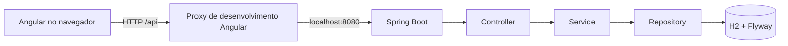
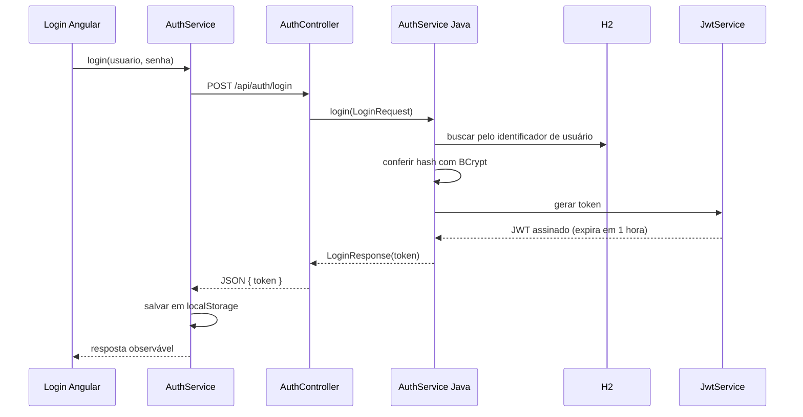

# Arquitetura

## Visão geral

O projeto é um monorepo com frontend Angular e backend Spring Boot. O backend segue organização em camadas; o frontend usa componentes standalone, Angular Router e serviços para acessar a API.



O proxy existe apenas no servidor de desenvolvimento. Em produção, configurar proxy reverso no host ou CORS explícito no backend.

## Tecnologias atuais

### Backend

- Java 21 e Spring Boot 4.1.1.
- Spring Web MVC, Spring Security e Spring Data JPA.
- Flyway e H2.
- SpringDoc OpenAPI 3.1.0.
- JJWT 0.12.7.

### Frontend

- Angular 21, TypeScript e Angular Material.
- Standalone Components, Angular Router, Reactive Forms e RxJS.
- `HttpClient` registrado na configuração da aplicação.

## Estrutura implementada

```text
backend/src/main/java/com/leticia/gestaoalunos/
├── config/       # Spring Security e configuração
├── controller/  # AuthController e controller de teste
├── dto/          # LoginRequest e LoginResponse
├── entity/       # Usuario
├── repository/   # UsuarioRepository
├── security/     # JwtService e JwtAuthenticationFilter
├── service/      # AuthService
└── util/         # utilitários

frontend/src/app/
├── core/
│   ├── models/   # modelos de autenticação
│   └── services/ # AuthService
└── features/
	└── auth/login/ # componente, template e estilos de login
```

As pastas de alunos, turmas, layout e guards estão previstas na arquitetura, mas ainda não contêm funcionalidades de negócio implementadas.

## Fluxo de autenticação atual



O contrato atual envia `usuario` e `senha`. A conta de autenticação não armazena e-mail. O frontend e o backend validam o identificador alfanumérico (mínimo 8 caracteres) e a senha (8 a 20 caracteres, com letras e números).

## API e segurança atuais

- `POST /api/auth/login`: público; valida credenciais e retorna JWT.
- `/swagger-ui/**`, `/v3/api-docs/**` e `/h2-console/**`: públicos no `SecurityConfig` atual.
- Outras rotas: Spring Security exige autenticação.
- `JwtAuthenticationFilter` procura `Authorization: Bearer <token>`.
- Senhas são comparadas com BCrypt. O JWT inclui o identificador de usuário no `subject`, claim `role` e validade de uma hora.
- O JWT fica em `localStorage` sob a chave `siga_auth_token`.

Limitações conhecidas: a área `/inicio` é apenas a entrada protegida e a API de alunos ainda não existe; CORS não está configurado no backend. Logout, guard, interceptor e matriz de perfis estão implementados. O segredo JWT é configurado pela variável de ambiente `JWT_SECRET`. Detalhes em [`autenticacao-login.md`](autenticacao-login.md).

## Persistência

O `application.properties` usa `jdbc:h2:mem:alunosdb`, portanto o banco é volátil. Flyway cria atualmente apenas `usuario` e insere um administrador inicial. Não existe ainda entidade ou tabela de alunos/turmas. O estado atual e o modelo futuro esperado estão separados em [`diagrama-banco.md`](diagrama-banco.md).

## Comandos principais

```powershell
# Backend
cd backend
.\mvnw.cmd spring-boot:run
.\mvnw.cmd test

# Frontend (em outro terminal)
cd frontend
npm install
npm start
npm run build
```

O frontend usa `src/proxy.conf.json` durante `ng serve`, com destino `http://localhost:8080`.
