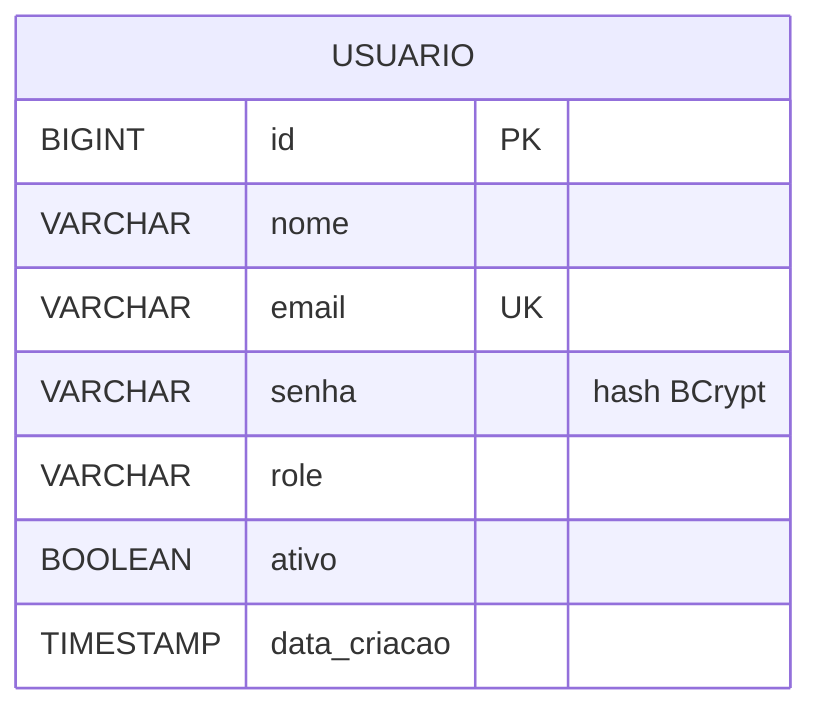

# Banco de Dados

## Modelo implementado

As migrations atuais criam apenas a tabela `usuario`. O banco configurado é H2 em memória (`jdbc:h2:mem:alunosdb`); os dados são recriados ao reiniciar a aplicação.

### Colunas de `usuario`

| Coluna         | Tipo         | Restrição/uso                                                                |
| -------------- | ------------ | ---------------------------------------------------------------------------- |
| `id`           | BIGINT       | Chave primária autoincrementada.                                             |
| `nome`         | VARCHAR(150) | Obrigatório.                                                                 |
| `email`        | VARCHAR(150) | Obrigatório e único; usado atualmente no login.                              |
| `senha`        | VARCHAR(255) | Obrigatório; armazenar o hash BCrypt, nunca a senha em texto puro.           |
| `role`         | VARCHAR(50)  | Perfil, por exemplo `ADMIN`.                                                 |
| `ativo`        | BOOLEAN      | Obrigatório, com padrão `TRUE`. O login atual ainda não verifica esse valor. |
| `data_criacao` | TIMESTAMP    | Obrigatório, com padrão `CURRENT_TIMESTAMP`.                                 |

Origem: `backend/src/main/resources/db/migration/V1__init.sql` e `V2__insert_admin.sql`. A migration V2 insere o administrador inicial com senha armazenada como hash; consulte as configurações locais para credenciais, não as registre neste documento.

## Modelo exigido para alunos (a implementar)

O Protótipo 2.0 exige cadastro de alunos, mas ainda não existe entidade, migration ou tabela `aluno` no código. O requisito funcional inclui os seguintes dados; tipos, nomes físicos e relacionamentos devem ser definidos na migration antes da implementação:

| Dado            | Regra funcional                                                           |
| --------------- | ------------------------------------------------------------------------- |
| Nome completo   | Obrigatório, 3–120 caracteres.                                            |
| E-mail          | Obrigatório, válido e único entre registros vigentes.                     |
| CPF             | Obrigatório, validar dígitos e unicidade sem máscara.                     |
| Telefone        | Persistir somente dígitos após validar DDD e número.                      |
| Foto            | Opcional, JPEG/PNG, até 5 MB. Decidir estratégia de armazenamento.        |
| Matrícula       | Gerada pelo backend, única e imutável.                                    |
| Status          | Ativo inicialmente; permitir inativação.                                  |
| Exclusão lógica | Indicador para manter histórico e ocultar registros excluídos dos ativos. |

Não há relacionamento aluno-turma especificado nesta fase obrigatória; turmas estão fora do escopo do protótipo.

## Regras para evoluir o schema

- Criar migrations Flyway novas; não editar migrations já aplicadas em ambientes compartilhados.
- Usar tabelas minúsculas e colunas `snake_case`, conforme convenções do projeto.
- Definir índices/constraints para matrícula, CPF e e-mail únicos; a regra de unicidade de e-mail deve considerar registros vigentes.
- Implementar constraints no banco além das validações da API quando aplicável.
- Atualizar este diagrama quando migrations reais forem adicionadas; manter separado o esquema existente do modelo planejado.
