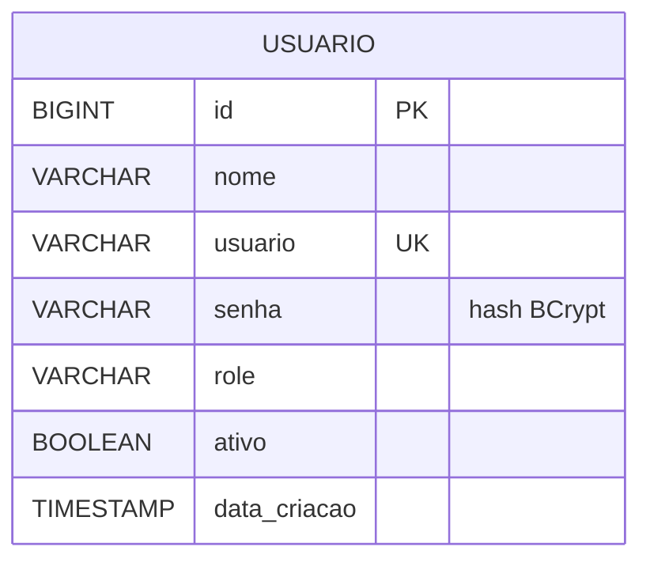
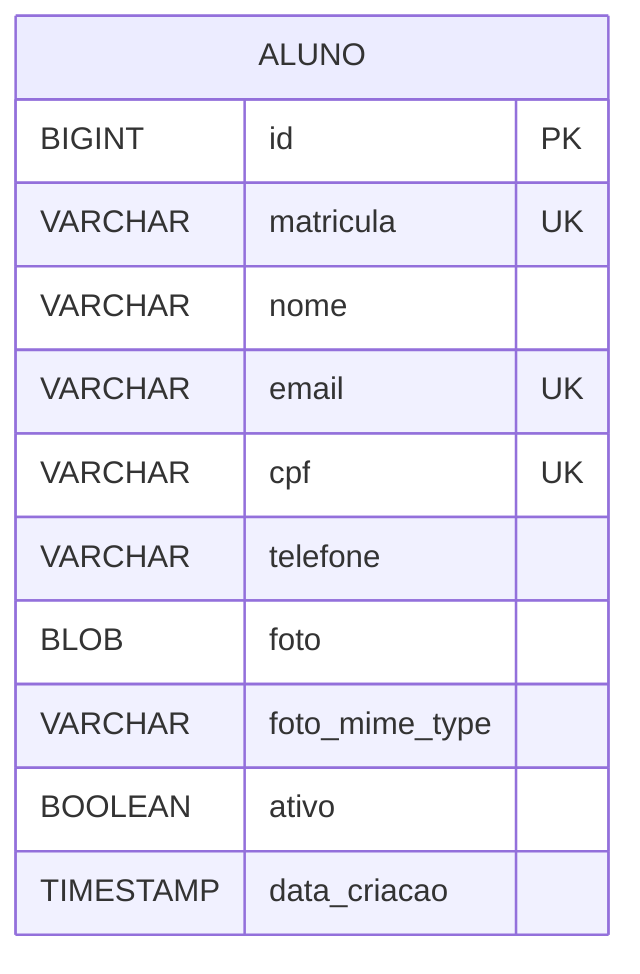

# Banco de Dados

## Modelo implementado

As migrations atuais criam as tabelas `usuario` e `aluno`. O banco configurado é H2 em memória (`jdbc:h2:mem:alunosdb`); os dados são recriados ao reiniciar a aplicação.

### Colunas de `usuario`

| Coluna         | Tipo         | Restrição/uso                                                                |
| -------------- | ------------ | ---------------------------------------------------------------------------- |
| `id`           | BIGINT       | Chave primária autoincrementada.                                             |
| `nome`         | VARCHAR(150) | Obrigatório.                                                                 |
| `usuario`      | VARCHAR(50)  | Obrigatório e único; identificador usado no login, alfanumérico com mínimo de 8 caracteres. |
| `senha`        | VARCHAR(255) | Obrigatório; armazenar o hash BCrypt, nunca a senha em texto puro.           |
| `role`         | VARCHAR(50)  | Perfil, por exemplo `ADMIN`.                                                 |
| `ativo`        | BOOLEAN      | Obrigatório, com padrão `TRUE`. O login atual ainda não verifica esse valor. |
| `data_criacao` | TIMESTAMP    | Obrigatório, com padrão `CURRENT_TIMESTAMP`.                                 |

Origem: migrations `V1__init.sql`, `V2__insert_admin.sql`, `V3__add_usuario_login.sql`, `V4__remove_email_from_usuario.sql` e `V5__set_admin_dev_password.sql`. A migration V3 atribui identificadores às contas existentes e define `admin1234` para o administrador inicial; V4 remove o e-mail da conta de autenticação; V5 atualiza o hash para uma senha de desenvolvimento que atende às regras atuais. Não use a credencial seedada em produção.

## Modelo do aluno

O schema de `aluno` foi criado pela migration `V6__create_aluno_table.sql`. Matrícula, CPF e e-mail são únicos em todos os registros; `ativo` indica se o aluno está ativo, mantendo os inativos consultáveis.

| Coluna           | Tipo         | Restrição/uso |
| ---------------- | ------------ | ------------- |
| `id`             | BIGINT       | Chave primária autoincrementada. |
| `matricula`      | VARCHAR(20)  | Obrigatória e única; 8 dígitos numéricos no formato `AAAA####` (ano + sequência anual), gerada pelo backend. |
| `nome`           | VARCHAR(120) | Obrigatório; API valida 3–120 caracteres e os caracteres permitidos. |
| `email`          | VARCHAR(150) | Obrigatório, validado e único. |
| `cpf`            | VARCHAR(11)  | Obrigatório; dígitos verificadores validados, único e armazenado sem máscara. |
| `telefone`       | VARCHAR(11)  | Obrigatório; API valida DDD/número e persiste somente dígitos. |
| `foto`           | BLOB         | Opcional; API aceita JPEG/PNG até 5 MB e armazena os bytes no banco. |
| `foto_mime_type` | VARCHAR(50)  | Opcional; obrigatório quando `foto` estiver presente. |
| `ativo`          | BOOLEAN      | Obrigatório, padrão `TRUE`; inativação preserva o registro. |
| `data_criacao`   | TIMESTAMP    | Obrigatório, padrão `CURRENT_TIMESTAMP`. |

Foto em BLOB foi escolhida para a primeira versão, sem infraestrutura externa. A API limita o tamanho a 5 MB e aceita JPEG/PNG. A tela de detalhes baixa o conteúdo pela chamada autenticada `GET /api/alunos/{id}/foto`. Em escala maior, avaliar armazenamento externo.

O requisito funcional inclui os seguintes dados:

| Dado            | Regra funcional                                                           |
| --------------- | ------------------------------------------------------------------------- |
| Nome completo   | Obrigatório, 3–120 caracteres.                                            |
| E-mail          | Obrigatório, válido e único entre registros vigentes.                     |
| CPF             | Obrigatório, validar dígitos e unicidade sem máscara.                     |
| Telefone        | Persistir somente dígitos após validar DDD e número.                      |
| Foto            | Opcional, JPEG/PNG, até 5 MB; armazenamento atual em BLOB.                |
| Matrícula       | Gerada pelo backend, única, imutável e composta por 8 dígitos: ano atual e sequência anual de 4 dígitos. |
| Status          | Ativo inicialmente; permitir inativação.                                  |
| Exclusão lógica | Indicador para manter histórico e ocultar registros excluídos dos ativos. |

Não há relacionamento aluno-turma especificado nesta fase obrigatória; turmas estão fora do escopo do protótipo.

## Regras para evoluir o schema

- Criar migrations Flyway novas; não editar migrations já aplicadas em ambientes compartilhados.
- Usar tabelas minúsculas e colunas `snake_case`, conforme convenções do projeto.
- Matrícula, CPF e e-mail têm constraints únicas na tabela `aluno`.
- Implementar constraints no banco além das validações da API quando aplicável.
- Atualizar este diagrama quando migrations reais forem adicionadas; manter separado o esquema existente do modelo planejado.
